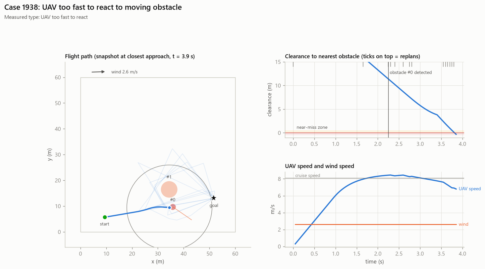

# Case 1938

**Measured causes (counterfactual reruns):** UAV too fast to react

## Full-evidence explanation (gemini:gemini-3.1-flash-lite)

The UAV collided with a moving obstacle at 3.9 seconds, resulting in a minimum clearance of -0.32 meters. The failure was primarily caused by the UAV's cruise speed of 8.1 m/s, as reducing this speed by 30% prevented the failure according to the counterfactual analysis.

Factors: `uav_speed` ← `counterfactuals.slower`

Confidence: high

## Same LLM, trace only (no counterfactuals)

The UAV collided with a moving obstacle at 3.9 seconds, resulting in a minimum clearance of -0.32 meters. Despite detecting the obstacle at 2.2 seconds with a 16.0 meter gap, the UAV's cruise speed of 8.1 m/s combined with the obstacle's movement prevented a successful avoidance maneuver.

Factors: `moving_obstacle`, `uav_speed`
