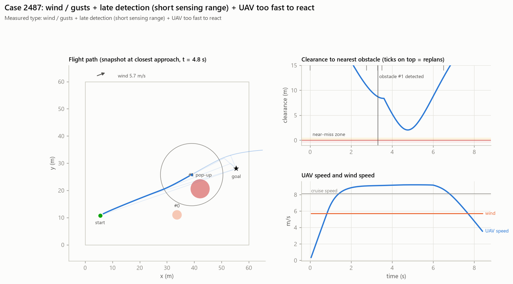

# Case 2487

**Measured causes (counterfactual reruns):** wind / gusts + late detection (short sensing range) + UAV too fast to react

## Full-evidence explanation (gemini:gemini-3.1-flash-lite)

The flight failed due to a combination of high cruise speed and a tailwind of 5.7 m/s, which prevented the UAV from reacting in time to a late-detected obstacle. Counterfactual analysis confirms that reducing the UAV speed by 30%, increasing sensing range to 25 m, or removing the wind would have prevented the failure.

Factors: `wind` ← `counterfactuals.no_wind`, `late_detection` ← `counterfactuals.full_sensing`, `uav_speed` ← `counterfactuals.slower`

Confidence: high

## Same LLM, trace only (no counterfactuals)

The UAV failed due to an out-of-bounds error after a late detection of an obstacle at 3.3 seconds, leaving only 1.4 seconds to react before the closest approach. Additionally, the flight was impacted by a 5.7 m/s tailwind, which likely contributed to the UAV's inability to maintain its path and stay within the designated area.

Factors: `late_detection`, `wind`
