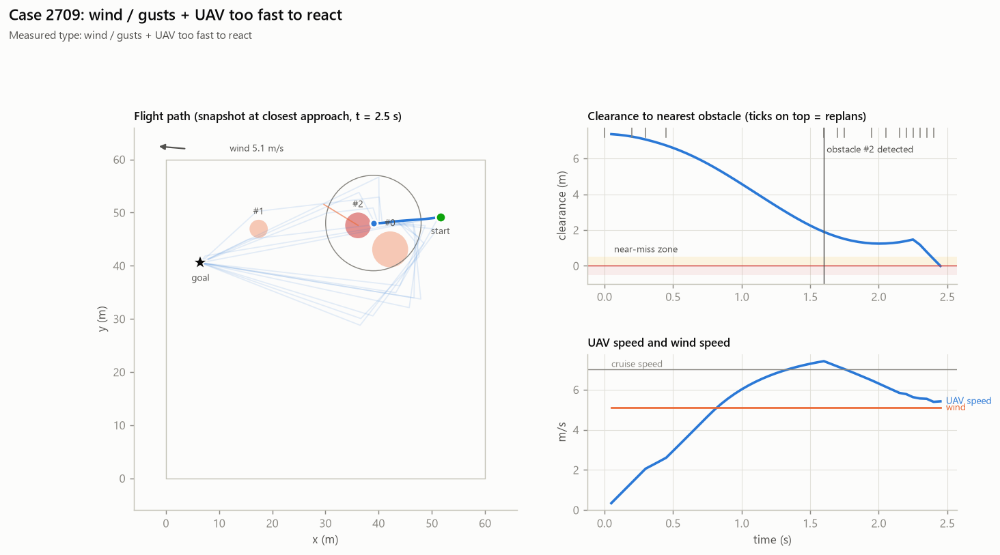

# Case 2709

**Measured causes (counterfactual reruns):** wind / gusts + UAV too fast to react

## Full-evidence explanation (gemini:gemini-3.1-flash-lite)

The UAV collided with a moving obstacle after only 2.5 seconds of flight. The failure was primarily caused by the 5.1 m/s tailwind and the UAV's cruise speed of 7.0 m/s, as both removing the wind and reducing the speed prevented the collision.

Factors: `wind` ← `counterfactuals.no_wind`, `uav_speed` ← `counterfactuals.slower`

Confidence: high

## Same LLM, trace only (no counterfactuals)

The UAV collided with a moving obstacle at 2.5 seconds, resulting in a minimum clearance of -0.01 meters. The collision occurred only 0.9 seconds after the obstacle was detected, leaving insufficient time for the UAV to adjust its path while traveling at a cruise speed of 7.0 m/s.

Factors: `moving_obstacle`, `uav_speed`
