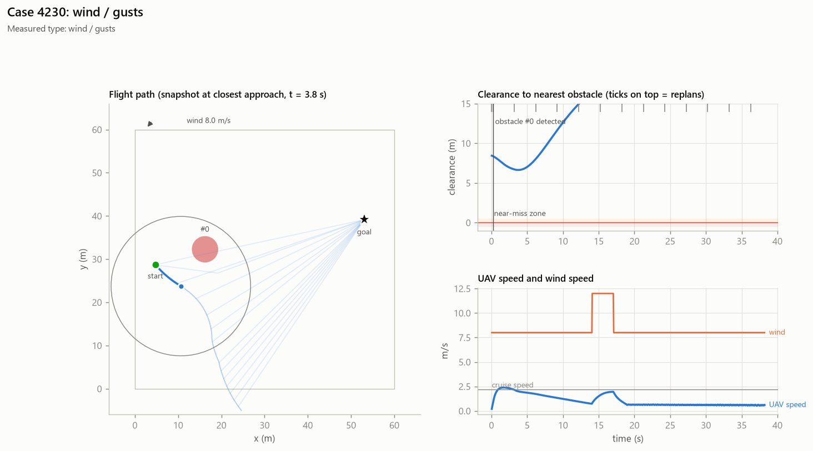

# Case 4230

**Measured causes (counterfactual reruns):** wind / gusts

## Full-evidence explanation (gemini:gemini-3.1-flash-lite)

The UAV failed due to excessive wind conditions, specifically a crosswind of 8.0 m/s combined with gusts reaching 4.0 m/s. The trace confirms the UAV experienced a maximum wind force of 12.0 m/s, and the counterfactual analysis explicitly states that removing the wind would have prevented the failure.

Factors: `wind` ← `counterfactuals.no_wind`

Confidence: high

## Same LLM, trace only (no counterfactuals)

The UAV failed due to an out-of-bounds condition caused by excessive wind. The flight encountered a maximum wind speed of 12.0 m/s, which significantly exceeded the UAV's cruise speed of 2.2 m/s, leading to a final distance to the goal of 52.5 meters.

Factors: `wind`
