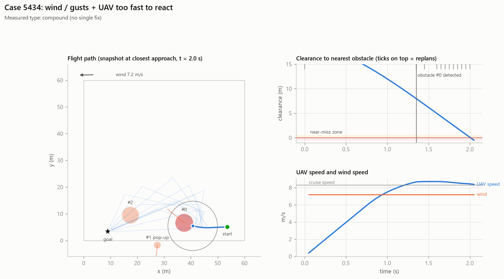

# Case 5434

**Measured causes (counterfactual reruns):** compound (no single fix)

## Full-evidence explanation (gemini:gemini-3.1-flash-lite)

The UAV collided with a moving obstacle at 2.0 seconds, resulting in a minimum clearance of -0.51 meters. Despite the UAV traveling at 8.3 m/s, the combination of high speed and the presence of moving obstacles made the collision unavoidable, as confirmed by the failure of all counterfactual scenarios.

Factors: `moving_obstacle` ← `trace.closest_obstacle.moving`, `uav_speed` ← `scenario.uav_cruise_speed_m_s`

Confidence: high

## Same LLM, trace only (no counterfactuals)

The UAV collided with a moving obstacle at 2.0 seconds, resulting in a minimum clearance of -0.51 meters. The collision was caused by the late detection of the obstacle at 1.4 seconds, leaving only 0.7 seconds for the planner to react while traveling at a cruise speed of 8.3 m/s.

Factors: `moving_obstacle`, `late_detection`
