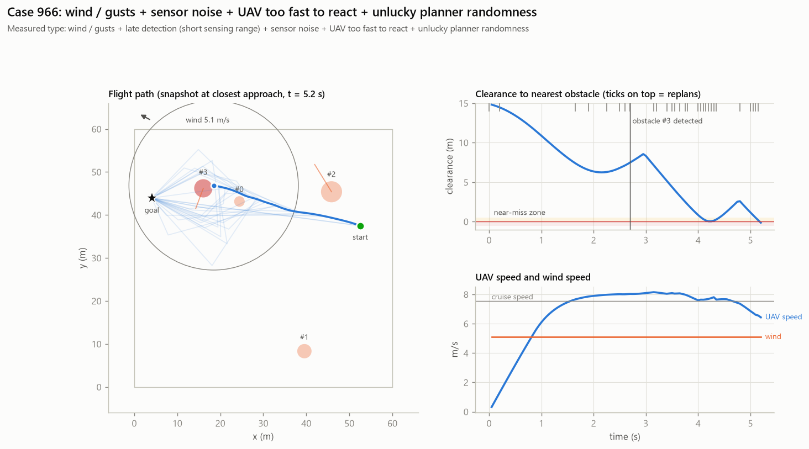

# Case 966

**Measured causes (counterfactual reruns):** wind / gusts + late detection (short sensing range) + sensor noise + UAV too fast to react + unlucky planner randomness

## Full-evidence explanation (gemini:gemini-3.1-flash-lite)

The UAV collided with a moving obstacle at 5.2 seconds due to a combination of factors. The 5.1 m/s crosswind, 0.4 m sensor noise, and high cruise speed of 7.6 m/s prevented the UAV from maintaining clearance, as confirmed by counterfactuals. Additionally, the flight outcome was sensitive to planner randomness, as re-seeding the RRT algorithm prevented the failure.

Factors: `wind` ← `counterfactuals.no_wind`, `uav_speed` ← `counterfactuals.slower`, `sensor_noise` ← `counterfactuals.no_noise`, `planner_randomness` ← `counterfactuals.reseed`

Confidence: high

## Same LLM, trace only (no counterfactuals)

The UAV collided with a moving obstacle at 5.2 seconds, resulting in a minimum clearance of -0.13 meters. The flight was significantly impacted by a 5.1 m/s crosswind, which, combined with the movement of the obstacle, prevented the planner from maintaining a safe trajectory.

Factors: `wind`, `moving_obstacle`
