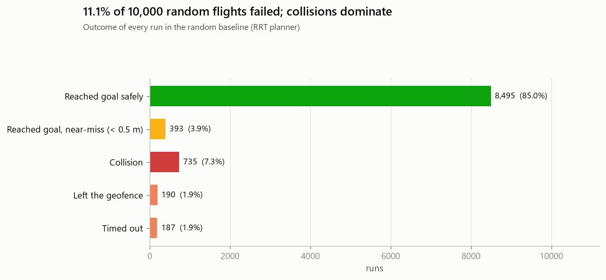
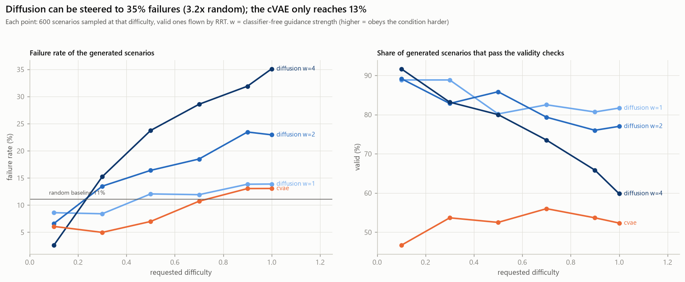
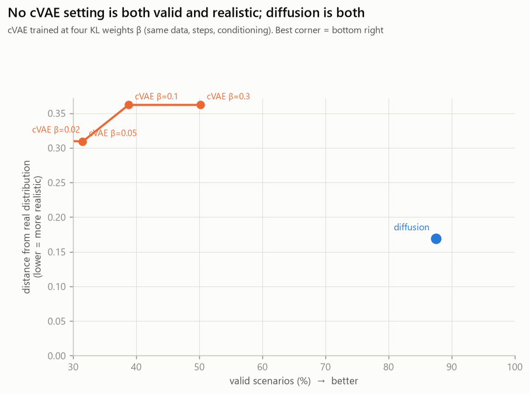
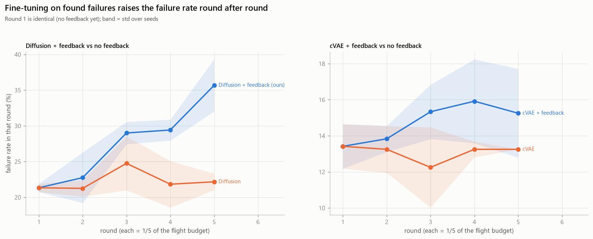
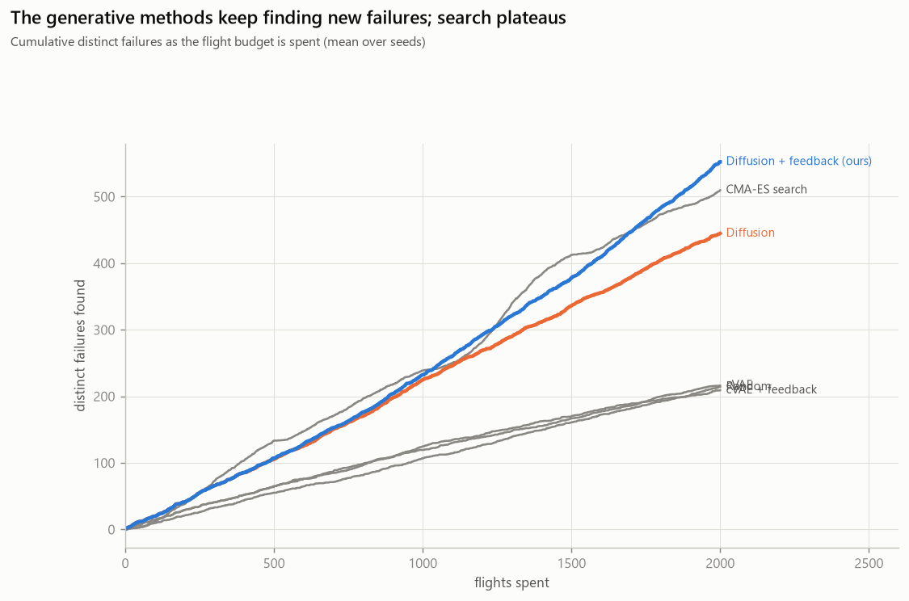
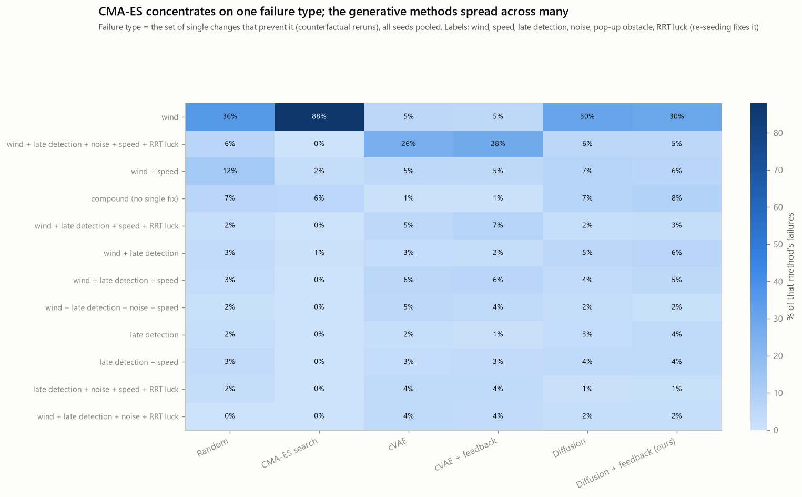
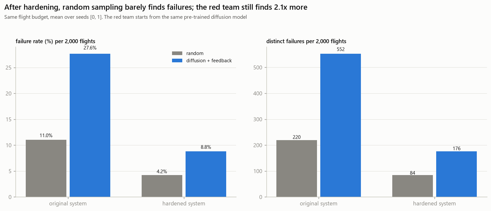

# Generative AI-Based Red-Teaming for Autonomous UAV Navigation: Final Report

CS787 project. Code, data pipeline and every figure below are reproducible from this repository
(see [Reproducing the results](#5-reproducing-the-results)). Demo video: [demo.mp4](demo.mp4) (2.5 min).
The academic write-up of the same work is `paper/report.pdf` in the submission repository.

## Summary

A path planner can only be trusted in the situations it has been tested in, and random testing rarely
reaches the rare combinations that break it. Following DiffScene [1], which used a diffusion model to generate
safety-critical driving scenarios, we built a red-teaming framework for UAV navigation. Generative models
search for failure-inducing scenarios, a simulator decides what actually happens, and an LLM explains each
failure using only measured evidence. The planner under test is the open-source PythonRobotics RRT / RRT\* [5],
used unmodified. Scenario statistics are grounded in real data (Stanford Drone Dataset [8] for obstacle
speeds, NOAA hourly weather [9] for wind and gusts).

| question | answer |
|---|---|
| Does failure-guided diffusion find more distinct failures than random sampling or direct search, for the same simulator budget? | Yes: **552** distinct failures per 2,000 flights vs **510** for CMA-ES search and **214** for random sampling. It also covers **109** of 384 scenario regions (CMA-ES 31) and finds **35** failure types in its first 200 failures (CMA-ES 8). |
| Why diffusion rather than a VAE? | As argued by DiffScene [1], diffusion is a better prior for rare events: our diffusion model is 87% valid and 2.1x closer to the real scenario distribution than the best cVAE (50% valid), and can be steered to 35% failures on request (cVAE: 13%). |
| Does learning from found failures help? | For diffusion, yes: failure rate rises from 21% to 36% over five rounds of fine-tuning, while it stays at about 22% without feedback. For the cVAE, only slightly (13% to 15%). |
| Are the LLM's explanations faithful? | With measured counterfactual evidence the LLM names 96% of confirmed causes; from the trace alone it names 34%, and 44% of its explanations blame a cause the reruns rule out. |
| Are the failures real? | They persist at 4x finer simulation steps and 77% of them also break RRT\*. |
| Can the findings improve the planner? | Four fixes targeted at the measured causes let the system survive 79% of all 8,650 past failures and cut the ordinary failure rate from 12.0% to 4.7%; re-attacking the hardened system, the red team still finds 2.1x as many distinct failures as random sampling. |

## 1. Setup

**Simulator** (`sim/simulator.py`). A 2D, 60 x 60 m world. The UAV tracks a desired velocity with an
acceleration limit (5 m/s²) and a turn-rate limit (1.5 rad/s). Wind acts as a force, with optional gusts.
The planner sees only obstacles within its sensing range, 0.2 s late, with position noise. It replans when a
new obstacle appears, when the current path becomes blocked, or every 3 s. A flight fails if it collides,
leaves the geofence or times out.

**Planner under test** (`planners/`). RRT and RRT\* from
[PythonRobotics](https://github.com/AtsushiSakai/PythonRobotics) (MIT), vendored unmodified behind a thin
adapter (seeding, silenced logging, shortcut smoothing).

**Scenario space** (`scenarios/`). A 46-number vector: start, goal, UAV speed; five obstacle slots (position,
velocity, radius, appearance time, active flag); mean wind, gust strength and timing; sensing range and noise.
Rule-based validity checks reject physically impossible scenarios.

**Real-world grounding** (`scenarios/real_data.py`). The random scenario generator draws moving-obstacle speeds
from 149,000 one-second track segments of the Stanford Drone Dataset [8] (pedestrians median 1.2 m/s, cyclists
3.5 m/s) and wind and gusts from 8,753 hourly NOAA observations at San Francisco airport in 2023 [9] (median
wind 4.1 m/s, gusts in 13% of hours). The generators learn from these scenarios.

**Fairness rule** (`scenarios/validity.py`). A scenario is rejected if an obstacle appears inside the UAV's
reaction distance (sensing delay plus braking distance, plus the obstacle's own motion) along its route.
Without it, search methods learned to "win" by spawning obstacles directly in front of the UAV. The rule cut
such unavoidable crashes from 18% to 6.5% of our method's failures and from 41% to 18% of CMA-ES's; the rest
come from the UAV drifting off its nominal route and are flagged by `loop/metrics.unavoidable_mask`.

**Failure score F** (`loop/scoring.py`), fixed before any experiment: collision (0.4) + goal not reached (0.2)
+ low clearance (0.2) + replans (0.1) + path deviation (0.1). A flight that reaches the goal with less than
0.5 m clearance is a *near-failure*.

**Random baseline** (`reports/01_random_baseline/`). 10,000 random scenarios: 11.1% fail (7.3% collisions).
These flights are also the training data for the generators.



## 2. Methods

| method | what it does |
|---|---|
| Random | samples the procedural generator |
| CMA-ES search | black-box optimiser maximising F directly over the 46 scenario numbers, 4 restarts |
| cVAE | conditional VAE asked for maximum difficulty (KL weight tuned by a 4-point sweep) |
| Diffusion | conditional DDPM [6] (3.4M parameters, classifier-free guidance [7]) asked for maximum difficulty |
| + feedback | after each of 5 rounds, the generator is fine-tuned on the seed data plus the de-duplicated failures found so far |

DiffScene [1] steers a diffusion model with gradients of a learned adversarial objective at sampling time. We
use classifier-free guidance on a difficulty condition plus closed-loop fine-tuning on simulator-confirmed
failures instead, which needs no differentiable surrogate of the planner.

**Counterfactual analysis** (`analyst/counterfactuals.py`). Every failure is re-flown with one factor changed:
no wind, full sensing range, no sensor noise, late obstacles present from the start, 30% slower UAV, or three
fresh planner seeds. A change that turns the failure into a success is a *measured cause*. The set of such
changes defines the failure's *type*.

**Grounded LLM analyst** (`analyst/`). Gemini (free tier, `gemini-3.1-flash-lite`) receives a structured evidence
record (scenario, trace, counterfactual results, and the three most similar past failures retrieved from the
failure library) and returns JSON. Every cause it names must cite an evidence field; a script rejects
citations that do not exist. The simulator, not the LLM, decides the outcome.

## 3. Results

### 3.1 Generators (`reports/02_generators/`)



Asked for harder scenarios, diffusion delivers them: 35% failures at guidance 4 (60% valid) or 23% at
guidance 2 (77% valid), against 11.1% for random sampling. The cVAE reaches at most 13%. Generated scenarios
are new rather than copied: their median distance to the nearest training scenario (1.04) is close to that of
brand-new random scenarios (1.10).

The cVAE was tuned fairly: a sweep of its KL weight (0.02-0.3) never got it above 50% validity, and its
realism distance (0.31-0.36) stayed about twice that of diffusion (0.17). This matches DiffScene's motivation
for diffusion over VAE-based generators such as STRIVE [3].



### 3.2 Red-team loop (`reports/03_red_team_loop/`)



### 3.3 Method comparison (`reports/05_comparison/`)

Six methods, 2,000 flights each, 3 seeds (mean ± std):

| method | failures | distinct failures | regions covered (of 384) | failure types in first 200 failures | flights to 50th distinct |
|---|---|---|---|---|---|
| Random | 215 ± 15 | 214 ± 15 | 112 ± 2 | 28 ± 2 | 461 ± 51 |
| CMA-ES search | **743 ± 109** | 510 ± 71 | 31 ± 2 | 8 ± 3 | 234 ± 51 |
| cVAE | 262 ± 4 | 216 ± 2 | 84 ± 5 | **36 ± 4** | 374 ± 48 |
| cVAE + feedback | 295 ± 9 | 209 ± 8 | 80 ± 3 | 35 ± 4 | 375 ± 51 |
| Diffusion | 445 ± 19 | 445 ± 20 | **116 ± 1** | **36 ± 3** | **230 ± 22** |
| **Diffusion + feedback** | 553 ± 22 | **552 ± 21** | 109 ± 2 | 35 ± 4 | **230 ± 22** |



CMA-ES produces the most raw failures but 31% of them are near-duplicates, and 88% are wind-only failures in
one corner of the space (slow UAV, strong wind). Diffusion + feedback combines the most distinct failures
with broad coverage.



### 3.4 LLM analyst (`reports/04_llm_analyst/`)

50 crashes, each explained four times with different evidence (200 explanations):

| evidence given | precision | recall | contradicted by reruns | cites missing evidence |
|---|---|---|---|---|
| trace only | 63% | 34% | 44% | 0% |
| + similar past cases (retrieval) | 59% | 36% | 60% | 0% |
| + counterfactual reruns | 100% | 92% | 0% | 0% |
| all evidence | 98% | 96% | 2% | 0% |

The counterfactual variants are scored against evidence they were shown, so their scores measure faithful use
of evidence. The independent result is the first two rows: an LLM reading the trace alone is often wrong about
the cause, and retrieving similar past cases does not fix this (the model tends to copy their failure type).
Causes should be measured by the simulator and only interpreted by the LLM.

### 3.5 Fidelity checks (`reports/06_fidelity_checks/`)

| failures from | still fail at dt = 0.05 s (as found) | 0.025 s | 0.0125 s |
|---|---|---|---|
| random sampling | 78% | 77% | 76% |
| diffusion + feedback | 78% | 78% | 76% |

(Each failure re-flown with 3 fresh planner seeds; "still fails" = at least 2 of 3 fail. The first column is
the planner-randomness baseline.) On the same 2,000 random scenarios RRT\* fails 12.4% (RRT 12.2%), and 77% of
the failures found against RRT also break RRT\*, for the same measured causes.

### 3.6 Harden and re-attack (`reports/07_harden_and_reattack/`)

Fixes added around RRT (the planner code is unchanged), each targeting a top measured cause: wind feed-forward
in the controller, a speed governor tied to sensing range, best-of-3 planning, and a wider footprint for moving
obstacles.

- **Regression:** the hardened system survives 79% of the 8,650 failures found so far. Compound failures are
  hardest to fix (42% survived); failures found by CMA-ES are the most persistent (65% survived).
- **Side effects:** on 3,000 ordinary scenarios the failure rate falls from 12.0% to 4.7% and flights take
  6% longer; 61 scenarios that used to succeed now fail.
- **Re-attack:** against the hardened system, random sampling finds 84 distinct failures per 2,000 flights and
  diffusion + feedback finds 176.



After hardening, wind remains the most common measured cause (60%) but late detection is close behind (50%),
which points to the next fix (longer sensing range or more conservative speed near unseen space).

## 4. Threats to validity and limitations

- **2D, simplified dynamics.** Mitigated by acceleration and turn limits, wind force, delayed noisy sensing and
  the time-step check, but results do not transfer directly to real quadrotors.
- **Partial real-data grounding.** Obstacle speeds and wind come from real data, but obstacle layouts, sensing
  parameters and the UAV model are synthetic, and the wind comes from one airport.
- **Residual unavoidable failures.** The fairness rule uses the UAV's nominal route; 6.5% of our failures (18%
  of CMA-ES's) still involve an obstacle appearing within braking time because the UAV drifted off route.
- **Metric design choices.** The near-duplicate threshold (1.0 in model space), the 384-cell coverage grid and
  the failure-type definition were chosen by us. CMA-ES's ranking is sensitive to the duplicate threshold
  (743 raw failures vs 510 distinct). Random sampling and plain diffusion cover slightly more grid regions,
  and the cVAE finds as many failure types per 200 failures; we report all of them.
- **Few uniquely-found failure types.** Only 2 failure types are found by our method and no other. Its
  advantage is volume, spread and speed of distinct discoveries.
- **Baseline tuning.** The cVAE posterior-collapsed at its first setting and was re-tuned; CMA-ES used default
  settings with restarts. Better-tuned baselines could narrow the gap.
- **Generator trained on one planner.** The diffusion model learned difficulty from RRT flights; it was not
  retrained for the hardened system (the feedback loop adapted it).
- **LLM evaluation.** Scored automatically against counterfactuals, on 50 cases, with one model; no human
  rating of usefulness.
- **Not done:** the held-out-region robustness test from the proposal, human ratings, and CTGAN.

## 5. Reproducing the results

```powershell
python -m experiments.run_all          # every stage below, in order, resumable (log in data/run_all.log)
```

or stage by stage:

```powershell
python -m scenarios.real_data                                                 # real-data statistics (needs the raw downloads)
python -m experiments.run_random --n 10000 --seed 0 --out seed_rrt.parquet   # stage 1 data
python -m experiments.report_baseline                                         # reports/01
python -m experiments.train_generators                                        # models/
python -m experiments.tune_cvae                                               # cVAE beta sweep
python -m experiments.report_generators                                       # reports/02
python -m experiments.run_comparison                                          # data/comparison
python -m experiments.report_comparison                                       # reports/03, 05
python -m experiments.run_llm_ablation --n 50                                 # reports/04 (needs GEMINI_API_KEY)
python -m experiments.run_fidelity                                            # reports/06
python -m experiments.run_hardening                                           # reports/07
python -m experiments.make_demo                                               # reports/demo.mp4
```

Every stage folder has a README and reads in the same order: `1_runs` (videos and flight pictures) →
`2_results` (charts and CSVs) → `3_crash_reasons` (measured causes).

## 6. Context and Prior Literature

This work builds upon the conceptual foundations established by **DiffScene** [1], which pioneered the application of diffusion models for safety-critical scenario generation in autonomous driving. DiffScene argued that Denoising Diffusion Probabilistic Models (DDPMs) provide a better prior for rare-event synthesis than VAE-based generators (e.g., STRIVE [3]) and adversarial trajectory optimization (e.g., AdvSim [4]), because diffusion can sample from the low-density tail of a valid distribution without sacrificing physical plausibility. Our generator comparison (Section 3.1) reproduces this finding in the UAV domain.

### 6.1 Why DiffScene Was Chosen as the Base Paper and Project Motivation

We selected DiffScene as our primary base paper for four key reasons:
1. **Rare-event synthesis:** DiffScene supports the core premise of our hypothesis: autonomous navigation cannot be certified by uniform or random testing because critical failures reside in the low-density long tail of operating environments.
2. **Diffusion over VAEs and black-box search:** DiffScene argued that black-box search tends to collapse onto a few failure modes and that VAE-based generators lose realism when pushed toward high risk. We observe both effects: CMA-ES concentrates 88% of its failures in one type, and the cVAE never exceeds 50% validity.
3. **Multi-objective risk balancing:** DiffScene's decomposition of risk into safety ($\mathcal{J}_{\text{safe}}$), functionality ($\mathcal{J}_{\text{fun}}$), and physical constraint satisfaction ($\mathcal{J}_{\text{con}}$) is the blueprint for our failure score F (collision, goal not reached, clearance, replans, deviation) plus validity checks.
4. **Downstream hardening:** DiffScene showed that generated scenarios are useful for improving the system under test, not only for measuring it.

### 6.2 How DiffScene Motivated Our Extensions in UAV Red-Teaming

1. **Domain shift to aerial robotics and environmental disturbances:** DiffScene tests ground vehicles in CARLA. We investigate whether diffusion red-teaming discovers compound failures in UAV flight caused by wind, gusts, delayed noisy sensing and moving obstacles.
2. **Algorithmic planners rather than learned policies:** DiffScene evaluated RL driving policies. Safety-critical robotics often relies on sampling-based planners such as RRT and RRT\*; we test them unmodified.
3. **Closed-loop feedback instead of a learned surrogate:** DiffScene guides sampling with gradients of a learned adversarial objective. We instead fine-tune the generator on simulator-confirmed failures over 5 rounds, which needs no differentiable model of the planner.
4. **An interpretability layer:** DiffScene reports *that* failures occur, not *why*. We add counterfactual reruns and a grounded LLM analyst (98% precision, 96% recall on measured causes), whose findings guided the four hardening fixes (79% of past failures survived).

## References

1. Chejian Xu, Ding Zhao, Alberto Sangiovanni-Vincentelli, Bo Li. *DiffScene: Diffusion-Based Safety-Critical Scenario Generation for Autonomous Vehicles.* 2nd AdvML Frontiers Workshop at ICML, 2023. Extended version: Chejian Xu, Aleksandr Petiushko, Ding Zhao, Bo Li. AAAI 2025, 39(8): 8797-8805.
2. Chejian Xu, Wenhao Ding, Weidong Lyu, Zuxin Liu, Shuai Wang, Yuntian He, Hanjiang Hu, Ding Zhao, Bo Li. *SafeBench: A Benchmarking Platform for Safety Evaluation of Autonomous Vehicles.* NeurIPS Datasets and Benchmarks, 2022.
3. Davis Rempe, Jonah Philion, Leonidas J. Guibas, Sanja Fidler, Or Litany. *Generating Useful Accident-Prone Driving Scenarios via a Learned Traffic Prior.* CVPR, 2022.
4. Jingkang Wang, Ava Pun, James Tu, Sivabalan Manivasagam, Abbas Sadat, Sergio Casas, Mengye Ren, Raquel Urtasun. *AdvSim: Generating Safety-Critical Scenarios for Self-Driving Vehicles.* CVPR, 2021.
5. Atsushi Sakai, Daniel Ingram, Joseph Dinius, Karan Chawla, Antonin Raffin, Alexis Paques. *PythonRobotics: a Python code collection of robotics algorithms.* arXiv:1808.10703, 2018; Sertac Karaman, Emilio Frazzoli. *Sampling-based algorithms for optimal motion planning.* IJRR, 2011.
6. Jonathan Ho, Ajay Jain, Pieter Abbeel. *Denoising Diffusion Probabilistic Models.* NeurIPS, 2020.
7. Jonathan Ho, Tim Salimans. *Classifier-Free Diffusion Guidance.* NeurIPS Workshop on Deep Generative Models, 2021.
8. Alexandre Robicquet, Amir Sadeghian, Alexandre Alahi, Silvio Savarese. *Learning Social Etiquette: Human Trajectory Understanding in Crowded Scenes.* ECCV, 2016 (Stanford Drone Dataset).
9. NOAA National Centers for Environmental Information. *Integrated Surface Database (ISD), station 72494023234 (San Francisco Intl. Airport), 2023.* Accessed via the NOAA Open Data Dissemination program on AWS.
