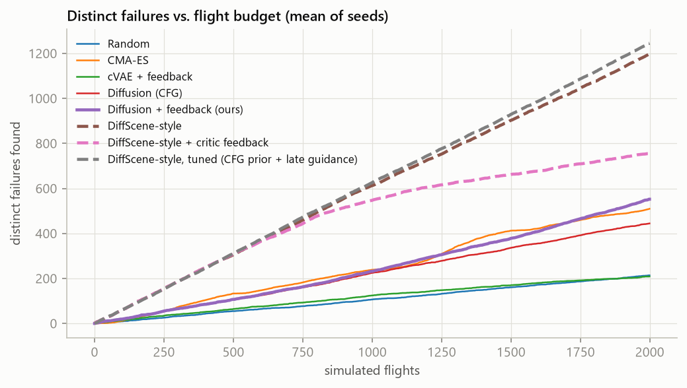

# DiffScene-style baseline: gradient guidance through a learned critic

Report Sec. 4.6 and 5.7, Table 5. Code: `generators/diffscene.py`, `experiments/run_diffscene.py`,
`experiments/tune_diffscene.py`, `experiments/run_diffscene_tuned.py`.

**Method.** Our trained diffusion model, used unconditionally as the prior. At every denoising step the
predicted clean scenario takes 3 gradient-ascent steps on a learned critic's predicted failure score, with a
proximal penalty that keeps it near the prior's prediction (DiffScene's constraint objective), then is
re-noised. The critic is an MLP trained on the same 10,000 seed flights (held-out AUC for failure
0.80, R² for F 0.15). Step size α = 3 was chosen by a pilot
sweep on a separate seed (`data/diffscene_info.json`). "+ critic feedback" refits the critic after each round
on everything flown so far. Same budget (2,000 flights, 5 rounds), validity and fairness filter and metrics as
the main comparison.

**Tuned version.** A sweep of 14 variants on a separate pilot seed (400 flights each; `tuning_sweep.csv`)
tried a failure classifier as critic, critic ensembles with an uncertainty penalty, normalised gradients, a
learned validity term, late guidance, and a classifier-free-guided prior. The selection rule, fixed in
advance, was the most distinct failures among variants with at least 70% of our coverage and at most 10%
unavoidable failures. The winner, "DiffScene-style, tuned", uses our CFG prior (F = 1, w = 2) and applies
the critic gradient (alpha = 2) only in the last half of the denoising steps.

| method | failures | distinct_failures | coverage_cells | types_in_first_200 | failure_types | top_type_share | unavoidable_share | validity | realism_w | mean_wind | most common type |
|---|---|---|---|---|---|---|---|---|---|---|---|
| Random | 215 ± 15 | 214 ± 15 | 112 ± 2 | 28 ± 2 | 28 ± 2 | 36% | 4.5% | - | 0.02 | 4.3 | no_wind |
| CMA-ES | 743 ± 109 | 510 ± 71 | 31 ± 2 | 8 ± 3 | 18 ± 1 | 88% | 17.8% | - | 0.90 | 5.7 | no_wind |
| cVAE + feedback | 295 ± 9 | 209 ± 8 | 80 ± 3 | 35 ± 4 | 39 ± 1 | 28% | 0.9% | 68% | 0.55 | 3.4 | no_wind,full_sensing,no_noise,slower,reseed |
| Diffusion (CFG) | 445 ± 19 | 445 ± 20 | 116 ± 1 | 36 ± 3 | 47 ± 3 | 30% | 4.9% | 76% | 0.55 | 4.6 | no_wind |
| Diffusion + feedback (ours) | 553 ± 22 | 552 ± 21 | 109 ± 2 | 35 ± 4 | 46 ± 3 | 30% | 6.5% | 80% | 0.61 | 4.7 | no_wind |
| DiffScene-style | 1203 ± 21 | 1197 ± 20 | 54 ± 1 | 23 ± 1 | 37 ± 2 | 33% | 6.6% | 17% | 1.03 | 6.4 | compound |
| DiffScene-style + critic feedback | 904 ± 89 | 756 ± 78 | 54 ± 3 | 23 ± 1 | 34 ± 2 | 63% | 8.4% | 4% | 0.56 | 6.4 | no_wind |
| DiffScene-style, tuned (CFG prior + late guidance) | 1246 ± 14 | 1245 ± 14 | 57 ± 6 | 22 ± 4 | 41 ± 3 | 34% | 5.6% | 23% | 0.95 | 6.3 | no_wind |

Coverage is out of 384 cells. `top_type_share` is the share of failures with the most common measured type;
`realism_w` is the mean 1-D Wasserstein distance of flown scenarios to the seed data (in seed standard deviations,
lower is more realistic); `unavoidable_share` counts failures where an obstacle appeared within braking time.

## Strengths and weaknesses

- **DiffScene-style: targeting.** The critic gradient optimises every sample toward a high predicted failure
  score: about 60% of flights fail (ours 28%), and it finds 2.3x more distinct failures. They are fair (share of
  unavoidable failures no higher than ours) and not collapsed onto one type (CMA-ES: 88% one type).
- **DiffScene-style: narrow and less realistic.** The gradient points most samples the same way (strong wind,
  fast flight), so it covers half as many scenario regions and finds fewer failure types per 200 failures. It
  also pushes samples off the data manifold: only 17-23% pass the validity rules (ours 80%) and the realism gap
  is larger. Refitting the critic on its own flights makes it worse (the guidance exploits the critic).
- **Ours: diverse and realistic, but less targeted.** Classifier-free guidance learns "hard" jointly with the
  scenario distribution and needs no surrogate of the planner, so samples stay valid and spread out; most of
  its flights succeed, though.
- **Together.** The best DiffScene variant uses our CFG prior plus a late critic gradient: the mechanisms are
  complementary.
